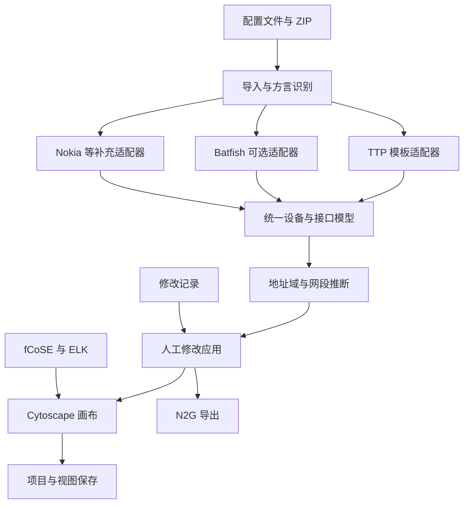

# IP 地址拓扑还原 App：开发计划

> **版本：** v1.0  
> **日期：** 2026-10-24  
> **状态：** 开发规划，尚未开始应用实现或使用真实配置进行兼容性验收  
> **原则：** 优先复用开源组件，以统一数据模型连接解析、推断、人工编辑和导出  
> **目标形态：** 本机或内网部署的 Web App

## 1. 项目目标

开发一个基于网络设备配置的 IP 逻辑拓扑还原与编辑工具。用户上传 Huawei、Juniper、Cisco、Nokia 的配置文件，或包含多份配置的 ZIP，系统自动提取接口 IPv4、IPv6 信息，在明确的地址域内识别同网段关系，生成可解释、可人工修正、可自由摆放的拓扑。

### 1.1 用户使用流程

1. 创建项目并上传单个文件、多个文件或 ZIP。
2. 自动识别厂商、操作系统及配置格式，允许人工修正识别结果。
3. 查看解析出的设备、接口、地址、VRF 和解析警告。
4. 确认必要的地址域映射，生成拓扑。
5. 点击设备或链路检查来源配置、匹配规则和疑点。
6. 修正链路、设备信息或地址域，拖动节点或运行自动布局。
7. 保存项目及多个命名视图。
8. 导出项目 JSON、PNG、CSV 和可编辑的 draw.io 文件。
9. 重新上传配置后保留有效的人工修正与布局，并报告冲突。

### 1.2 产品语义

- **配置事实：** 文件中明确存在且已成功解析的设备、接口、地址和关联信息。
- **推断关系：** 根据地址、前缀、地址域及规则生成的候选逻辑连接。
- **人工确认：** 用户对某个具体关系的确认；不自动等同于实时运行状态。
- **观测关系：** 后续由 LLDP/CDP、接口状态等运行态数据提供的证据。
- **显示视图：** 对业务数据的展示方式，包括坐标、分组、过滤器和布局。

同网段可以形成三层逻辑互联推断，不能仅凭 IP 配置证明物理直连、接口处于运行状态或端到端可达。画布应明确显示关系来源与审阅状态。

## 2. 范围与优先级

| 优先级 | 功能 | 完成要求 |
| --- | --- | --- |
| P0 | 单文件、多文件、ZIP 导入 | 文件独立处理，批量进度与结果可查看 |
| P0 | 四厂商目标方言识别 | 按 OS 和格式建立支持矩阵，可人工指定 |
| P0 | IPv4、IPv6 接口地址提取 | 支持多地址、掩码、前缀、地址角色与来源 |
| P0 | 设备、接口、VRF、聚合关系 | 统一模型，保留厂商原始名称和上下文 |
| P0 | 同网段关系推断 | 地址域隔离、共享网段节点、双栈合并、平行链路 |
| P0 | 质量报告与来源定位 | 成功、部分成功、失败；可查看原始配置位置 |
| P0 | 人工修正 | 新增、拒绝、改接、字段覆盖、地址域调整 |
| P0 | 手工摆放与常用布局 | 拖动、固定节点、撤销、布局恢复 |
| P0 | 项目与视图持久化 | 重新打开、重新导入后保留有效修改 |
| P0 | JSON、PNG、CSV、draw.io 导出 | 导出内容与当前项目或选定视图一致 |
| P1 | 配置快照差异 | 显示设备、地址、接口和链路的增删改 |
| P1 | LLDP/CDP、接口状态导入 | 增加物理邻接及运行态证据 |
| P1 | 精细端口锚点、正交走线 | 将布局计算与画布端点几何正确衔接 |
| P1 | SVG 导出、大图优化 | 单独验证样式、字体、分组和并行边 |
| P1 | Nokia SR Linux | 作为独立平台适配 |
| 后续 | 多人协作、权限、在线采集 | 在核心闭环稳定后扩展 |

首版的“支持”必须落实到**方言、配置格式、字段与验收样本**。遇到不支持的语义时，产生明确诊断，不把部分解析包装成完整支持。

## 3. 关键技术决策

| 编号 | 决策 | 原因与约束 |
| --- | --- | --- |
| ADR-01 | Python 后端解析，浏览器负责交互 | 直接复用网络解析生态，集中管理批量任务与版本 |
| ADR-02 | TTP 与现成接口模板作为主要解析路径 | 优先复用已有字段提取能力，缺口通过方言适配补齐 |
| ADR-03 | Batfish 作为可选增强组件 | 按目标版本、平台和具体 API 验证输出，避免扩大能力承诺 |
| ADR-04 | Cytoscape.js 作为唯一主画布 | 适合设备图、网状关系、并行边和布局扩展 |
| ADR-05 | fCoSE、ELK 与内置布局组合 | 复用成熟算法，并明确各算法的固定节点能力 |
| ADR-06 | 业务模型与图形模型分开 | 配置事实、证据、人工修改不依赖图形库内部 JSON |
| ADR-07 | 以接口和网段成员关系为基础 | 两端点可折叠为链路，多端点保留网段节点 |
| ADR-08 | 人工修改独立持久化 | 重算和重新导入后能够重放、检查冲突、保留布局 |
| ADR-09 | N2G 负责可编辑图文件导出 | 复用 draw.io/GraphML 输出能力 |
| ADR-10 | 本机或内网部署作为首版基线 | 配置处理、项目数据和后台任务在同一部署环境内管理 |

## 4. 开源组件集成方案

### 4.1 组件清单

| 能力 | 组件 | 集成方式 | 实施阶段 |
| --- | --- | --- | --- |
| 模板解析 | [TTP](https://github.com/dmulyalin/ttp) | Python 解析引擎，模板由应用维护 | M0–M1 |
| 厂商接口模板 | [ttp_templates](https://github.com/dmulyalin/ttp_templates) | 优先复用 platform 接口配置模板和转换函数 | M0–M1 |
| Nokia Classic 解析 | [ttp_sros_parser](https://github.com/h4ndzdatm0ld/ttp_sros_parser) | 候选适配器，先验证版本、双栈和服务上下文 | M0–M1 |
| 配置语义补充 | [Batfish](https://github.com/batfish/batfish)、[pybatfish](https://github.com/batfish/pybatfish) | 可选服务，通过适配器接入经过验证的字段 | M0 验证，后续按收益启用 |
| IP 计算 | [ipaddress](https://docs.python.org/3/library/ipaddress.html) | 使用标准库校验地址、规范化前缀和比较网段 | M1–M2 |
| 接口名辅助处理 | [netutils](https://github.com/networktocode/netutils) | 使用已适配的名称规范化函数，始终保留原始名称 | M1 |
| 图画布 | [Cytoscape.js](https://js.cytoscape.org/) | React 管理页面，Cytoscape 管理图形交互 | M3 |
| 力导向布局 | [fCoSE](https://github.com/iVis-at-Bilkent/cytoscape.js-fcose) | 适用于网状结构，支持部分位置约束 | M3 |
| 分层等布局 | [elkjs](https://github.com/kieler/elkjs) | 布局适配器，优先使用 Web Worker | M3 |
| 拖动连线 | [edgehandles](https://github.com/cytoscape/cytoscape.js-edgehandles) | 复用连线 UI，业务层明确选择两个接口 | M3 |
| 撤销重做 | [undo-redo](https://github.com/iVis-at-Bilkent/cytoscape.js-undo-redo) | 注册业务操作，使画布和持久化数据同步撤销 | M3 |
| 可编辑图导出 | [N2G](https://github.com/dmulyalin/N2G) | 将最终业务图和坐标映射到 draw.io/GraphML | M4 |
| 运行态文本解析 | [TextFSM](https://github.com/google/textfsm)、[NTC Templates](https://github.com/networktocode/ntc-templates) | 解析 LLDP/CDP、接口状态等命令输出 | P1 |

### 4.2 现成能力与集成边界

#### TTP 与模板

优先选择较完整的 platform 接口模板。已检查的 Cisco IOS、IOS-XR、NX-OS 与 Junos set 接口模板包含 IPv4/IPv6 字段或规则。模板存在不等于已通过目标设备的兼容性验证，必须锁定版本并逐字段验收。

参考模板：

- [Cisco IOS / IOS-XE 接口配置](https://dmulyalin.github.io/ttp_templates/ttp_templates/platform.cisco_ios_show_running_config_pipe_section_interface/)
- [Cisco IOS-XR 接口配置](https://dmulyalin.github.io/ttp_templates/ttp_templates/platform.cisco_xr_show_running_config_interface/)
- [Cisco NX-OS 接口配置](https://dmulyalin.github.io/ttp_templates/ttp_templates/platform.cisco_nxos_show_running_config_interface/)
- [Junos display set 接口配置](https://dmulyalin.github.io/ttp_templates/ttp_templates/platform.juniper_junos_show_configuration_interfaces_pipe_display_set/)
- [Huawei 接口 IP 模板](https://dmulyalin.github.io/ttp_templates/ttp_templates/misc.N2G.cli_ip_data.huawei/)

旧 N2G 专用模板与 platform 模板的覆盖范围不同。不能把某一个目录中的模板能力概括为整个 TTP 生态的能力，也不能直接宣称现成模板已经完成四厂商全部双栈支持。

#### N2G

[N2G IP 插件](https://n2g.readthedocs.io/en/latest/data_plugins/cli_ip_data.html) 已有接口 IP、网段图及相关可视化能力。项目优先复用其模板资产、导出和经过验证的基础构图能力。

App 仍保留自己的地址域、证据、关系身份与修改记录。能显示 VRF 标签不等于已经正确处理跨设备地址域与地址复用。N2G 的输入输出通过适配器与业务模型隔离。

#### Batfish

[Batfish 2026.08.27 发布说明](https://github.com/batfish/batfish/releases) 已新增 **Nokia SR OS MD-CLI** 支持，包括层级和扁平配置形式。不能根据旧文档把 Nokia 统一列为“不支持”，也不能把 MD-CLI 支持扩展为 Classic CLI 或 SR Linux 的完整支持。

[接口属性公开文档](https://batfish.readthedocs.io/en/latest/notebooks/configProperties.html) 的 All_Prefixes、Primary_Address 等仍以 IPv4 为核心。接入时分别验收：

1. 目标平台配置是否被接受。
2. 接口、VRF、聚合等字段是否正确输出。
3. IPv4 与 IPv6 地址是否真实出现在选用 API 的输出中。
4. 解析诊断是否完整保留。
5. 与主解析器发生冲突时，是否能明确展示差异。

不因解析器“没有报错”就判定双栈提取完整。未通过验证的字段由其他适配器补齐，或标记为未支持。

#### 许可证和依赖版本

在集成时记录每个实际使用版本的许可证、来源和本地补丁。N2G、TTP、ttp_templates、Cytoscape 核心采用 MIT；Batfish 采用 Apache-2.0；elkjs 的 [LICENSE](https://github.com/kieler/elkjs/blob/master/LICENSE.md) 为 EPL-2.0。扩展和传递依赖分别记录，不能用主库许可证代替整个依赖树。

### 4.3 自研范围

开发重点集中在：

- ZIP 导入、方言识别和纯配置备份的设备身份识别。
- 多引擎输出到统一模型的适配及来源定位。
- 开源模板尚未覆盖的厂商语义。
- 地址域映射、链路推断、双栈证据合并及冲突处理。
- 人工修正、重新导入对账和视图保存。
- 面向网络工程师的编辑与审阅界面。

多引擎之间采用明确的字段来源和优先级。补充解析结果作为可追踪证据，不把不同引擎返回的地址无条件拼接成“更完整”的结果。

## 5. 总体架构



### 5.1 推荐技术栈

| 层 | 技术 |
| --- | --- |
| 前端 | React、TypeScript |
| 图形 | Cytoscape.js |
| 布局 | fCoSE、elkjs、Cytoscape 内置布局 |
| API | Python、FastAPI |
| 数据校验 | Pydantic |
| 持久化 | SQLAlchemy、SQLite；多人版预留 PostgreSQL |
| 解析任务 | 独立后台进程和持久化任务状态 |
| 文件保存 | 部署环境内的项目文件目录 |
| 部署 | Docker Compose |
| 导出 | 项目 JSON、PNG、CSV、N2G draw.io |

### 5.2 模块边界

- **Import Service：** 解压、编码、文件分类、重复检查、批次与快照管理。
- **Parser Registry：** 平台识别、适配器选择、版本和能力声明。
- **Normalization Service：** 统一设备、接口、地址、上下文与来源。
- **Inference Service：** 地址域内的候选归组、特殊情况处理及证据生成。
- **Override Service：** 人工修改、修正冲突与重新导入重放。
- **Graph Projection Service：** 将业务关系转换为设备视图或网段视图。
- **Layout Adapter：** 为不同布局算法转换输入、约束和输出坐标。
- **Export Service：** 项目恢复文件、表格、图片与可编辑图。
- **Project Store：** 项目、快照、修改记录、视图及作业状态。

## 6. 多厂商解析设计

### 6.1 首版方言支持目标

以下是开发目标，实际支持状态以 M0/M1 的验收矩阵为准。

| 厂商/方言 | 目标输入 | 重点 |
| --- | --- | --- |
| Huawei VRP | 完整 current-configuration 文本 | sysname、IPv4 主从地址、IPv6、vpn-instance、Eth-Trunk、Vlanif、子接口 |
| Cisco IOS / IOS-XE | running-config | hostname、IPv4/IPv6、VRF、Port-channel、SVI、secondary |
| Cisco IOS-XR | running-config | ipv4 address、IPv6、VRF、Bundle-Ether、接口层级 |
| Cisco NX-OS | running-config | CIDR/掩码地址、vrf member、SVI、Port-channel、anycast 标记 |
| Junos | 层级格式、set 格式 | host-name、unit、inet/inet6、routing-instance、ae/irb/lo0、有效性 |
| Nokia SR OS Classic | Classic 配置文本 | router/Base、命名接口、port、LAG、VPRN、SAP、IPv4/IPv6 |
| Nokia SR OS MD-CLI | MD-CLI 配置文本 | router/interface、service/vprn、层级与扁平形式 |
| Nokia SR Linux | 后续独立适配 | interface/subinterface、network-instance、LAG、IRB |

### 6.2 处理步骤

1. **读取和预处理**
   - 识别编码，清理 BOM、终端控制序列和分页提示。
   - 保留原始文件、清理后的文本以及行号映射。
   - 不通过执行配置命令获得结果。

2. **识别方言**
   - 根据组合特征识别 vendor、OS 和 format。
   - 扩展名仅作辅助。
   - 识别不确定时允许人工选择解析器。

3. **建立语法上下文**
   - 接口块、routing-instance、VPRN、服务和聚合成员分别关联。
   - Junos、Nokia 层级数据需要上下文感知，不能只全文搜 IP。

4. **调用解析组件**
   - 使用已锁定的模板和适配器版本。
   - 只从正确的接口地址上下文提取地址。
   - BGP neighbor、ACL、静态路由、DNS/NTP 地址保留在其原语义中，不混入接口地址。

5. **标准化**
   - 规范化地址和前缀。
   - 保留原接口名与规范名、父接口、聚合成员和封装信息。
   - 区分真实、虚拟、动态、借用或未完全解析的地址。

6. **校验和报告**
   - 每文件返回 success、partial 或 failed。
   - 未解析语法、无效掩码、缺失关联和截断配置必须产生诊断。
   - 解析到零个地址时区分“设备确无三层地址”和“解析未覆盖”。

### 6.3 Junos 专项

必须分别处理：

- 层级配置与 set 格式。
- apply-groups、apply-groups-except。
- interface-range。
- 本地覆盖与继承来源。
- inactive: 与 deactivate。
- routing-instances 下的接口关联。

转换成 set 格式不等于展开继承。优先接受已经展开继承的完整导出；原始层级输入中未覆盖的继承语义产生部分解析诊断。官方说明见 [display inheritance](https://www.juniper.net/documentation/us/en/software/junos/cli-reference/topics/ref/command/show-pipe-display-inheritance.html)。

现有 Junos platform 模板的 VRF 说明与部分关联代码存在不一致，M0 必须检查实际 transform 输出，并补充针对性样例。

### 6.4 状态区分

```text
effective_state = active | inactive | unresolved
admin_state = enabled | disabled | unknown
oper_state = up | down | unknown
```

- active 表示配置语句有效，不表示接口在线。
- shutdown/disable 表示管理状态。
- 只有配置输入时，运行状态通常为 unknown。
- 配置缺省值只有在对应方言规则已验证时才能推导，否则保留 unknown。
- inherited 地址同时记录定义位置与应用位置，允许多个 source reference。

## 7. 统一数据模型

### 7.1 核心实体

| 实体 | 核心字段 |
| --- | --- |
| Project | id、name、description、settings、schema_version |
| Snapshot | id、project_id、import_batch、created_at、parser_versions |
| SourceFile | id、snapshot_id、filename、hash、encoding、parse_status、diagnostics |
| Device | 持久 id、hostname、vendor、OS、site、identity_evidence |
| RoutingContext | id、device_id、local_name、kind、RD、RT、原始上下文 |
| AddressDomain | id、name、成员映射、映射来源、确认状态 |
| Interface | 持久 id、device_id、routing_context_id、原名、规范名、kind、parent、members |
| Address | interface_id、AF、IP、prefix_length、network、role、origin、effective_state |
| Segment | domain、AF、prefix、成员接口、分组/拆分信息、推断状态 |
| Link | 端点接口、关系类别、地址族、来源、审阅状态、证据引用 |
| Evidence | 规则、源文件、行号/配置段、字段来源、解析器版本 |
| Override | 操作类型、目标锚点、修改内容、理由、基线、冲突状态 |
| View | 坐标、固定节点、过滤器、分组、标签、布局参数、视口 |
| ImportJob | 状态、进度、逐文件结果、错误、取消信息 |

### 7.2 地址和接口字段

```text
Interface
  id
  device_id
  routing_context_id
  raw_name
  normalized_name
  kind
  parent_interface_id
  physical_port_refs[]
  aggregate_members[]
  encapsulation
  description
  admin_state
  oper_state
  source_refs[]

Address
  interface_id
  family
  address
  prefix_length
  canonical_network
  role
  acquisition_method
  effective_state
  source_refs[]
```

role 可区分 primary、secondary、virtual、anycast、link_local、unknown；获取方式可区分 static、dhcp、slaac、unnumbered、derived、unresolved。

### 7.3 身份与去重

- Device、Interface 使用稳定 ID。
- hostname、IP、文件哈希不单独作为永久身份。
- 文件哈希用于发现相同输入或快照，不用于替代设备身份。
- 同名设备不得静默合并。
- 同设备的历史配置不得无条件叠加。
- 设备重识别依靠已有映射、上下文和人工确认。
- 一个设备可包含多个 RoutingContext；画布分组不能丢失这种多重归属。

## 8. 链路推断规则

### 8.1 地址域

候选匹配键：

```text
(address_domain_id, address_family, canonical_network, prefix_length)
```

地址域用于表达哪些接口允许在同一地址空间内比较。它不直接证明物理广播域存在。

必须支持：

- 不同客户复用同一私网前缀时隔离。
- 不同设备上同名 VRF 不自动等价。
- 不同名字的 VRF 可以映射到同一项目地址域。
- PE 的 VRF 接口可以与 CE 的 default 接口映射到同一地址域。
- 同一个候选前缀桶可由用户拆成多个独立网段。
- 默认项目地址域是一项显式假设；检测到 VRF 或大量重叠地址时提示调整映射。

RD 用于区分路由，RT 用于路由分发，不能直接充当二层邻接标识。参考 [RFC 4364](https://www.rfc-editor.org/rfc/rfc4364.html)。

### 8.2 匹配和生成关系

1. 规范化所有地址，检查地址与掩码合法性。
2. 将无效、未解析及特殊角色地址按规则分类。
3. 在确认或明确假设的地址域内，按精确前缀建立索引桶。
4. 以接口端点去重；同一接口在一个网段中的多个地址不是多个设备端点。
5. 根据端点数生成关系。
6. 分别检测重复 IP、前缀重叠、掩码不一致。
7. 按完整无向接口端点对合并双栈和多地址证据。
8. 应用人工修改。
9. 投影为设备视图或网段视图。

精确分桶阶段预期约为 O(N)，N 为地址记录数。重叠前缀诊断另行设计，不依赖全量接口两两比较，也不枚举 IPv6 网段内主机。

### 8.3 端点数量规则

| 情况 | 处理 |
| --- | --- |
| 一个有效端点 | 保留“未发现对端”记录 |
| 两个端点且属于不同设备 | 可折叠为一条配置推断链路 |
| 三个及以上端点 | 使用网段节点表达共享关系 |
| 两端属于同一设备 | 默认不产生设备自环，记录特殊/重叠配置提示 |
| 重复 IP | 产生冲突或虚拟地址待确认项，不因相同 IP 建链 |
| 地址域未确认或存在复用歧义 | 进入待确认结果，不标为确定物理连接 |

网段节点表示共享前缀关系，不代表系统发现了一台未上传配置的交换机。

### 8.4 双栈与平行链路

- 只有 IPv4、IPv6 指向相同的两个接口端点时才合并展示。
- 合并时保留各地址族的前缀、地址、来源和告警。
- 同设备对的不同接口对保持多条链路。
- 设备级连线聚合只是视图操作，可展开，不删除底层关系。
- IPv4 与 IPv6 指向不同端点时分别保留，提示复核。

### 8.5 特殊情况

| 场景 | 默认行为 |
| --- | --- |
| IPv4 /31 | 正常支持两个点到点端点，避免错误剔除网络/广播地址 |
| IPv6 /127 | 正常支持点到点互联 |
| Loopback | 保存用于设备识别和搜索，默认排除普通互联推断 |
| 普通 /32、/128 | 不仅凭相同单地址前缀推断互联；显式 peer 信息使用独立规则 |
| IPv6 link-local | 保留接口作用域，不跨设备按共同前缀连接 |
| VRRP/HSRP VIP | 与真实接口地址分开，不生成额外假端点 |
| Anycast | 结合配置语义或人工标记，不能仅凭地址字面值自动识别 |
| 聚合接口 | 地址归属逻辑聚合口；成员物理口对接关系需要其他证据 |
| 子接口 | 保留子接口身份、父口、VLAN/QinQ 等封装 |
| SVI/IRB/Vlanif | 生成三层逻辑关系，不推断物理接线 |
| 隧道接口 | 以逻辑关系类型呈现，不混同物理链路 |
| DHCP/SLAAC/EUI-64 未确定地址 | 保存配置方式和已知信息，不编造最终地址 |
| Unnumbered | 保存借用关系，避免依据被借用地址把所有接口连接起来 |
| 掩码不同、前缀重叠 | 报告待确认，不静默归并为同一个精确前缀 |
| shutdown/disable | 配置事实保留，可灰显或筛选；运行状态仍可为 unknown |
| inactive 地址 | 保留记录，不参与有效配置的默认推断 |
| 部分解析 | 对受影响接口和关系显示质量提示 |

协议依据：[RFC 3021](https://www.rfc-editor.org/rfc/rfc3021.html)、[RFC 6164](https://www.rfc-editor.org/rfc/rfc6164.html)、[RFC 4291](https://www.rfc-editor.org/rfc/rfc4291.html)。以上软件行为是本项目设计选择，协议引用用于说明地址语义。

### 8.6 可解释证据与审阅状态

```text
origin = inferred | manual | observed
review_state = pending | confirmed | rejected
```

每条推断至少能说明：

- 哪两个接口或哪些网段成员产生关系。
- 使用哪个地址域、地址族与规范前缀。
- 来源文件与配置段。
- 采用哪个规则和解析器版本。
- 是否存在缺失配置、地址冲突或未展开语义。

使用“条件充分”“待复核”“存在冲突”等规则状态。未经校准，不显示“95% 可靠”一类概率。

## 9. 人工修正与重新导入

### 9.1 支持的修改

- add_device / add_interface：补充缺失对象。
- force_link：人工连接两个明确接口。
- suppress_link：拒绝自动推断关系。
- rebind_endpoint：修正链路端点。
- assign_domain：修正地址域映射。
- split_segment：拆分错误归组的网段。
- override_field：覆盖设备、接口或地址字段，保留原值。
- set_position / pin_node：修改独立视图状态。
- add_note：添加解释或备注。

### 9.2 再导入逻辑

1. 创建新快照，保留旧快照。
2. 匹配已有设备和接口身份。
3. 重建配置事实与自动推断。
4. 应用仍能定位目标且前提成立的人工修改。
5. 当原字段变化、端点消失或身份不明确时，产生修改冲突。
6. 保留已有节点坐标，新节点放在相关区域或待摆放区。
7. 用户可查看旧值、新值和修改记录，决定保留、调整或撤销。

### 9.3 修改记录示例

```json
{
  "operation": "suppress_link",
  "target": {
    "interface_a_id": "if-a",
    "interface_b_id": "if-b",
    "relation_type": "ip_inferred"
  },
  "reason": "两个站点复用了该网段",
  "base_snapshot_id": "snapshot-001",
  "status": "active"
}
```

以上 ID 仅为数据结构示例。最终身份匹配和关系锚点必须包含足够上下文，避免 IP 变化后错误应用到另一条关系。

## 10. 界面与自动布局

### 10.1 主工作区

| 区域 | 内容 |
| --- | --- |
| 顶部 | 导入、布局、撤销/重做、保存、导出、视图选择 |
| 左侧 | 设备列表、站点、厂商、地址域、搜索和过滤 |
| 中央 | 拓扑画布、框选、拖动、缩放、分组 |
| 右侧 | 设备/接口详情、链路证据、原配置、修正操作 |
| 底部可展开区 | 解析诊断、冲突、未匹配接口、待确认关系 |

设备视图以设备为节点，链路两端显示简短接口名。网段视图显示网段节点及成员关系。完整配置按需加载，避免把大量原文塞入画布状态。

搜索支持 hostname、接口名、IPv4、IPv6 和网段。

### 10.2 布局能力

| 布局 | 组件 | 适用场景 |
| --- | --- | --- |
| 力导向 | fCoSE | 初次导入、网状互联、分组结构 |
| 分层 | ELK Layered | 核心—汇聚—接入，上下或左右排列 |
| 圆形 | Cytoscape circle | 小型环状展示 |
| 同心 | Cytoscape concentric | 按选定规则组织中心与外围 |
| 径向 | ELK radial | 从指定中心向外展开 |
| 树形 | breadthfirst / ELK mrtree | 树状、辐射结构 |
| 网格 | Cytoscape grid | 设备清单、孤立节点 |
| 手工/恢复 | preset 与保存坐标 | 精细摆放、恢复命名视图 |

分层角色由用户标签或明确规则提供，不能仅按节点度数就断言真实网络角色。布局只改变几何位置，不删除业务链路。

### 10.3 布局交互约束

- 支持全图和选中区域布局。
- 支持固定节点和布局撤销。
- 一次拖动、一次自动布局分别作为一个历史操作。
- fCoSE 的固定节点约束用于其明确支持的节点类型。
- 其他算法不支持所需固定约束时，限制作用范围或提示切换算法。
- 保存实际坐标，不把布局随机种子作为唯一恢复手段。
- 重导入默认保留位置，不自动打散全图。
- ELK 通过 Web Worker 执行；提供取消与结果应用。
- fCoSE 的 Worker 封装需验证，不能假设其天然提供相同执行方式。
- 端口锚点和正交走线由独立适配完成，属于 P1 增强。

参考：[Cytoscape 文档](https://js.cytoscape.org/)、[fCoSE 约束](https://github.com/iVis-at-Bilkent/cytoscape.js-fcose)、[ELK Layered](https://eclipse.dev/elk/reference/algorithms/org-eclipse-elk-layered.html)、[elkjs Worker](https://github.com/kieler/elkjs#usage)。

## 11. 导入、导出与运行要求

### 11.1 导入

- 支持单文件、多文件和 ZIP。
- ZIP 内递归识别配置文本，跳过无关元数据和非文本文件。
- 支持内容识别，不依赖文件必须为 .cfg 或 .conf。
- 可配置文件数、实际解压总量和嵌套深度限制。
- 校验解压路径、重复文件和异常压缩输入。
- 加密或不支持的归档返回明确错误。
- 单文件失败不影响其他文件。
- 同一设备存在多份配置时，由快照策略或用户选择决定采用哪份。
- 用户上传内容只作为待解析数据；应用使用受控模板。

### 11.2 导入结果表

字段至少包括：

```text
文件名
设备名
厂商 / OS / 格式
接口数
IPv4 数
IPv6 数
RoutingContext 数
解析状态
警告数
来源与详情入口
```

### 11.3 导出

| 格式 | 内容与用途 |
| --- | --- |
| 项目 JSON | 标准模型、修改记录、视图、schema_version，支持完整恢复 |
| PNG | 当前视图或完整画布，用于文档与沟通 |
| CSV | 设备、接口、地址、网段、链路清单 |
| draw.io | N2G 输出，包含可映射的节点位置和必要标签 |
| GraphML | 可作为后续附加导出 |
| SVG | P1 验证样式和导出组件后提供 |

原配置是否包含在项目文件中作为明确选项。项目 JSON 是应用内恢复格式；draw.io 主要用于外部编辑与交付，外部修改回流需另行设计。

### 11.4 数据与日志

- 原配置、结构化结果和日志分开保存。
- 日志避免记录整份配置和无关凭据。
- 默认导出结构化项目，原文由用户选择包含。
- 前端配置展示以文本处理。
- 后台任务记录状态、逐文件结果和失败原因；支持取消及中断后的明确状态恢复。

## 12. API 草案

以下是模块契约草案，M0 确认模型后再固定请求和响应结构。

| 方法 | 路径 | 用途 |
| --- | --- | --- |
| POST | /api/projects | 创建项目 |
| GET | /api/projects/{project_id} | 获取项目概况 |
| POST | /api/projects/{project_id}/imports | 上传配置与 ZIP，创建任务 |
| GET | /api/imports/{job_id} | 获取进度、结果和诊断 |
| POST | /api/imports/{job_id}/cancel | 取消导入 |
| GET | /api/projects/{project_id}/snapshots | 列出快照 |
| GET | /api/snapshots/{snapshot_id}/devices | 设备清单 |
| GET | /api/snapshots/{snapshot_id}/interfaces | 接口与地址清单 |
| GET | /api/snapshots/{snapshot_id}/diagnostics | 解析质量与冲突 |
| PUT | /api/projects/{project_id}/domains | 更新地址域映射 |
| POST | /api/snapshots/{snapshot_id}/infer | 生成或更新自动推断 |
| GET | /api/snapshots/{snapshot_id}/topology | 获取投影后的拓扑 |
| GET | /api/links/{link_id}/evidence | 获取链路依据 |
| POST | /api/projects/{project_id}/overrides | 提交人工修正 |
| GET | /api/projects/{project_id}/overrides | 查看修正与冲突 |
| PUT | /api/projects/{project_id}/views/{view_id} | 保存布局与视图 |
| POST | /api/projects/{project_id}/exports | 创建导出结果 |

重要约束：

- 查询明确对应 snapshot，避免混合不同时间的配置。
- 修改请求携带项目或修改记录版本，防止覆盖更新。
- 拓扑响应返回稳定 ID 和证据引用。
- 画布按需获取详情，避免一次返回所有源文件。
- 大批量解析采用异步作业，前端轮询或事件流接收进度。

## 13. 性能与测试计划

### 13.1 基准档位

建立 100、500、2,000 台设备的测试档位。它们是计划中的验证规模，不是已经实测的容量承诺。

记录：

- 配置文件数、原始总字节数。
- 接口数、IPv4/IPv6 地址数。
- 地址域数、候选网段数、可见节点/边数。
- 解析和推断耗时。
- 首次绘图和布局耗时。
- 拖动、搜索、筛选响应。
- 内存和导出耗时。

画布优化优先使用设备级视图、局部展开、站点/地址域过滤、分组折叠和缩放标签控制。

### 13.2 测试类型

- **解析回归：** 真实标注样本与最小边界样本。
- **模型契约：** 适配器输出符合统一结构，来源与未知值正确。
- **推断规则：** 地址域、双栈、平行链路、特殊地址和歧义。
- **持久化：** 项目重开、人工修改重放和冲突处理。
- **导出：** JSON 恢复、CSV 内容、PNG 和 draw.io 的节点/链路一致性。
- **交互：** 拖动、固定、撤销、布局和搜索。
- **输入稳健性：** 截断配置、无效地址、异常 ZIP、单文件失败。

### 13.3 核心验收案例

| 编号 | 输入/操作 | 预期结果 |
| --- | --- | --- |
| AT-01 | 两端 .0/31 与 .1/31 | 两个地址有效，一条候选关系 |
| AT-02 | 两端 IPv6 /127 | 正确生成 IPv6 候选 |
| AT-03 | 相同接口对具备 IPv4/IPv6 | 一条逻辑链路，两类证据 |
| AT-04 | 三台设备同 /24 | 一个网段节点，三条成员关系 |
| AT-05 | 两个客户复用同一 /30 | 按地址域隔离 |
| AT-06 | PE VRF 与 CE default 映射同域 | 正常生成候选 |
| AT-07 | 两设备间两个不同接口对 | 保留平行链路 |
| AT-08 | 只有 IPv6 link-local | 不凭共同前缀跨设备连线 |
| AT-09 | 两设备共享 VRRP/HSRP VIP | 不生成额外假端点 |
| AT-10 | /24 与 /25 范围重叠 | 提示掩码不一致，不静默合并 |
| AT-11 | 聚合口配置 L3 地址 | 地址不复制到每个成员口 |
| AT-12 | Junos 继承提供地址 | 正确展开或明确标记部分解析 |
| AT-13 | inactive 地址和 shutdown 接口 | 有效性与管理/运行状态正确区分 |
| AT-14 | 静态路由、ACL、BGP 中含 IP | 不混入接口地址清单 |
| AT-15 | 人工拒绝一条边后重导 | 拒绝继续生效 |
| AT-16 | 人工改接后新配置端点消失 | 报告修改冲突，不自动改接其他接口 |
| AT-17 | 手工摆放后关闭并重开 | 坐标、固定状态和视图恢复 |
| AT-18 | 一个文件解析失败 | 其他文件完成，失败原因可查看 |
| AT-19 | 两设备 hostname 相同 | 提示身份歧义，不静默合并 |
| AT-20 | 导出并重新导入项目 JSON | 数据、人工修正和视图一致 |

地址提取分别衡量精确率、召回率及接口/VRF 归属正确性。固定验收样本逐项通过后，再报告更大样本集的实际指标，不提前承诺“99% 准确率”。

## 14. 实施里程碑与任务清单

### M0：组件验证与数据契约

**目标：** 找到可直接复用的部分，识别字段和方言缺口。

- [ ] 收集各目标方言的脱敏样本和标注结果。
- [ ] 锁定 TTP、模板集合、图形组件等候选版本。
- [ ] 验证 Cisco、Huawei、Junos 的目标模板。
- [ ] 验证 Nokia Classic 候选解析器。
- [ ] 验证 Batfish Nokia MD-CLI 和其他拟使用 API。
- [ ] 分别确认 IPv4/IPv6 的实际输出。
- [ ] 明确 Junos 继承、有效性和 VRF 处理边界。
- [ ] 定义统一模型、适配器接口和诊断结构。
- [ ] 形成方言×字段支持矩阵。
- [ ] 记录许可证、已知问题和需要维护的模板补丁。

**交付物：** 能力矩阵、标注样本、标准输出、技术决策记录。

**完成门槛：** 每个首版目标方言都有可验证解析路径；缺口有明确补齐方案。

### M1：导入与接口清单

- [ ] 项目、快照、源文件和异步任务基础功能。
- [ ] 单文件、多文件、ZIP 导入。
- [ ] 编码、终端噪声、原文和行号映射。
- [ ] 设备与方言识别、人工指定。
- [ ] 统一设备/接口/地址/VRF 模型。
- [ ] 多地址、聚合、父接口和封装关联。
- [ ] 成功/部分成功/失败报告。
- [ ] 设备和接口浏览器、原配置定位。

**交付物：** 可使用真实配置验证的设备与接口清单。

**完成门槛：** 核心地址与归属字段通过标注样本；未支持语义不会静默丢失。

### M2：链路推断与证据

- [ ] 地址域映射与确认状态。
- [ ] 精确前缀分桶。
- [ ] 单端、双端和共享网段关系。
- [ ] 双栈合并、平行链路保留。
- [ ] 特殊地址、接口类型和配置状态规则。
- [ ] 重复 IP、掩码不一致和部分解析提示。
- [ ] 推断规则、源文件和配置段证据。
- [ ] 设备视图与网段视图投影。

**交付物：** 有来源、可解释的拓扑数据。

**完成门槛：** AT-01 至 AT-14 等相关规则案例通过。

### M3：画布、人工修正与布局

- [ ] 集成 Cytoscape 主画布。
- [ ] 拖动、框选、缩放、搜索和过滤。
- [ ] 设备与链路详情面板。
- [ ] 连线、拒绝、改接、字段覆盖和地址域调整。
- [ ] fCoSE、ELK 和内置布局适配。
- [ ] 固定节点、局部布局、布局撤销。
- [ ] 业务修改与图形撤销同步。
- [ ] 命名视图、坐标和视口保存。

**交付物：** 完整交互工作区。

**完成门槛：** 修改和布局可以保存、恢复、撤销，证据仍能正确定位。

### M4：重导入、导出与部署

- [ ] 重新导入的设备/接口身份匹配。
- [ ] 人工修改重放和冲突提示。
- [ ] JSON 导出、恢复与 schema_version。
- [ ] PNG、CSV、draw.io 导出。
- [ ] 导出内容与画布视图一致性验证。
- [ ] 规模基准测试和具体瓶颈修正。
- [ ] 本机/内网部署包与使用说明。
- [ ] 运行诊断、数据目录与备份说明。
- [ ] 所有首版验收案例回归。

**交付物：** 可持续使用的首版 App。

**完成门槛：** 上传、解析、推断、修正、保存、重新导入、导出完整闭环通过。

### 14.1 并行工作

M0 固定数据契约后：

- 解析与推断可以由后端任务推进。
- 前端可基于约定的拓扑 JSON 样例开发。
- 样本标注、兼容性矩阵和回归验证同步进行。
- 布局、导出组件先验证最小闭环，再加入复杂样式。

工期在 M0 完成后根据方言缺口和样本质量估算。演示原型与通过四厂商双栈验收的可用版分别管理。

## 15. 开发前输入与完成定义

### 15.1 建议准备的配置样本

- 每种实际使用方言提供少量完整脱敏配置。
- 至少一组真实互联两端配置，用于验证链路推断。
- 覆盖 IPv4、IPv6、VRF、子接口、聚合和共享网段。
- Nokia 明确是 Classic、MD-CLI 还是 SR Linux。
- Junos 至少提供常用导出格式；如使用继承，提供相应样本。
- 脱敏保留地址唯一性、同网段关系、VRF 重叠关系及接口关联。

### 15.2 首版完成定义

首版完成时，应能用约定样本执行以下全过程：

> 导入配置 → 查看接口与双栈地址 → 确认地址域 → 生成有证据的拓扑 → 人工修正 → 自动或手工布局 → 保存 → 重新导入后保留有效修改 → 导出项目与可编辑拓扑。

每个依赖的实际能力、未支持的输入和性能测试结果都可查；每条生成关系都可追踪其配置或人工来源。

