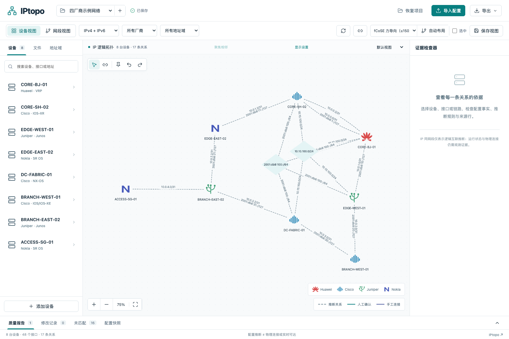

# IPtopo

从网络设备配置还原可解释、可编辑的 IP **逻辑**拓扑。本机或可信内网部署，Python/FastAPI + React/TypeScript + Cytoscape.js，SQLite 保存项目、不可变配置快照、人工修正和命名视图。

配置同网段只产生候选关系，不能证明物理直连或在线可达。只有配置输入时，运行状态为 `unknown`；“人工确认”也不代表实时运行状态。



## 启动

### Windows 双击启动

Windows x64 可使用免安装的 `IPtopo.exe`，自带前后端及 Python 运行环境。双击后自动打开浏览器，关闭启动窗口退出。数据保存在 `%LOCALAPPDATA%\IPtopo\data`，升级 EXE 不覆盖项目。下载构建和使用说明见 [Windows 版](docs/WINDOWS.md)；构建产物位于 [Windows executable 工作流](https://github.com/LiuMaoDou/IPtopo/actions/workflows/windows.yml)。

### Docker Compose

```sh
git clone https://github.com/LiuMaoDou/IPtopo.git
cd IPtopo
docker compose up --build -d
```

打开 [http://localhost:8765](http://localhost:8765)，API 文档在 [http://localhost:8765/docs](http://localhost:8765/docs)。数据保存在 `iptopo-data` Docker 卷。默认仅绑定本机；需要可信内网访问时设置 `IPTOPO_BIND=0.0.0.0`。本版为单用户工具，没有认证和多人权限，部署到公网前应在反向代理增加访问控制。

### 本机 Python / Node

需要 Python 3.12+、Node.js 22.12+（开发验证使用 Node 24）。

```sh
./scripts/dev.sh
```

若 `python3` 不是合适版本：

```sh
IPTOPO_PYTHON=/path/to/python3.12 ./scripts/dev.sh
```

开发前端热更新：

```sh
# 终端 1：完成依赖安装后运行 API
.venv/bin/python -m uvicorn backend.app.main:app --host 127.0.0.1 --port 8765
# 终端 2
cd frontend
npm run dev
```

Vite 将 `/api` 代理到 8765。API 进程必须使用 **一个 Uvicorn worker**；每个解析任务在独立进程执行，同时最多两个作业。生产构建由同一个 API 服务托管，无 CDN 或外部云服务依赖。

## 使用流程

1. 新建项目，上传单个/多个配置或 ZIP，或载入已标明为合成数据的示例项目。
2. 查看逐文件状态、厂商方言、接口和双栈地址。自动识别有误时可选解析器重新导入。
3. 检查地址域。默认上下文使用显式的“默认域假设”；各设备的 VRF 默认隔离，同名 VRF 不自动合并。可以将 PE VRF 与 CE default 映射到同一地址域。
4. 在设备/网段视图查看关系、接口端点、前缀与配置行号。三个以上端点通过网段节点表示，不展开成全互联。
5. 确认/拒绝关系、手动连线或改接、覆盖字段、添加设备/接口/备注、调整地址域和拆分网段。修改独立保存，可撤销/重新启用。
6. 拖动、固定节点、选择全图或局部布局，保存多个命名视图。坐标、固定状态、过滤和视口一起保存。
7. 重新上传同名文件更新该设备快照，其他文件默认保留；“替换”模式移除未在本次提供的配置。失败文件不会删除之前的有效配置。文件内设备名称或厂商变化时创建新身份并提醒复核。
8. 导出 JSON、PNG、CSV ZIP、draw.io。项目 JSON 包含全部配置事实快照、修正和视图，可恢复成独立项目；默认不包含原配置，可显式选择包含。CSV/draw.io 按选定已保存视图筛选；PNG 由当前画布生成。

设备身份以项目中持久保存的输入文件映射建立，不以 hostname 或 IP 自动合并。同名设备保留独立身份并报警。输入文件改名会建立新身份；请保留稳定的备份文件名。批次内部相同内容只处理一次。

## 解析范围

目标方言：Huawei VRP；Cisco IOS/IOS-XE、IOS-XR、NX-OS；Junos set/层级；Nokia SR OS Classic、MD-CLI flat/层级。

实际字段和边界详见 [支持矩阵](docs/SUPPORT_MATRIX.md)。仓库中的样本是**合成的回归样本**，没有宣称已通过真实设备全版本兼容性认证。Junos 未展开的 groups/interface-range 会产生部分解析诊断；Nokia SR Linux、运行态 LLDP/CDP、Batfish 增强、SVG、精细端口走线及多人协作不在本版实现范围。

## 验证与依赖

```sh
.venv/bin/python -m pip install -r requirements.lock
.venv/bin/python -m pytest backend/tests -q
cd frontend
npm ci
npm test
npm run build
```

`requirements.lock` 和 `frontend/package-lock.json` 锁定完整依赖。CI 在 Linux / Python 3.12 / Node 24 执行后端回归和前端构建。合成规模测试：

```sh
.venv/bin/python scripts/benchmark.py
.venv/bin/python scripts/generate_scale_samples.py --devices 1000 --output /tmp/iptopo-scale-1000.zip
.venv/bin/python scripts/benchmark_scale_api.py --devices 100 1000 2000
```

测试范围见 [验收记录](docs/VALIDATION.md)，100 / 1,000 / 2,000 台连通网络实测及复现步骤见 [性能报告](docs/PERFORMANCE.md)，组件来源及许可证见 [依赖说明](docs/DEPENDENCIES.md)。

## 大规模拓扑与图例

设备用不同厂商的矢量图标区分，名称显示在图标下方，画布图例给出厂商对应关系。链路的推断、人工确认、人工添加状态使用独立图例，避免与厂商混淆。

两台设备之间的多条链路默认聚合成粗线，并显示链路数量。单击查看成员列表，双击展开；再次双击任意成员链路可收起。每条链路的接口、地址和审阅状态仍独立保存，网段成员关系不聚合。

Junos 支持完整配置、接口子树以及带命令/编辑路径上下文的相对配置。更新解析器后，请重新导入原配置文件，已有快照不会自动重新解析。

大图首次打开采用快速连通分量摆放；重新导入只安排新增节点，保留已有坐标和固定状态。缩小时简化图标、文字及连线细节，放大或选中后恢复。可通过设备/接口/IP 搜索、厂商/地址族/地址域筛选及一跳邻居聚焦查看局部，并把局部视图保存、导出。

复杂布局在可取消的 Web Worker 中运行；大图避免在浏览器主线程直接执行全图力导向。设备列表按可见范围渲染，拖动保存只提交视图并返回轻量结果。具体阈值、实测和尚未覆盖的边界见性能报告。

## 数据、限制与备份

- 本机默认目录 `data/`；可通过 `IPTOPO_DATA_DIR` 修改。
- `iptopo.sqlite` 保存项目、快照、作业状态；`sources/` 保存解码后的原配置文本；`uploads/` 是作业临时文件。
- 默认最多 2,500 个配置文件，单文件 4 MiB，累计实际解压 64 MiB，ZIP 嵌套 3 层；通过 `IPTOPO_MAX_FILES`、`IPTOPO_MAX_FILE_BYTES`、`IPTOPO_MAX_TOTAL_BYTES`、`IPTOPO_MAX_ZIP_DEPTH` 调整。
- ZIP 递归读取，不按用户路径解压到磁盘；拒绝越界路径、符号链接、加密或不支持的归档；二进制与元数据跳过并报告。嵌套归档的实际展开数据也计入总量限制。
- 单文件错误独立报告；取消作业或重启中断时不会提交半个快照。重启后未完成作业标记 `interrupted`，可以重新上传。
- 更新请求带项目版本，冲突返回 409。导入期间暂停其他项目写入，避免新快照覆盖刚做的修正。
- 需要包含配置原文的便携备份，使用 JSON 导出并勾选包含原文。完整服务备份先停止服务，再复制整个数据目录/数据卷（包括数据库及 sources）。恢复时使用同版本或兼容 schema 的应用。
- 日志不输出配置正文。前端按纯文本显示配置。配置文件可能含凭据，请将数据目录和含原文的备份放在受控位置。

## 目录

```text
backend/app/     API、解析、推断、修正、SQLite、导入作业、导出
backend/tests/   解析/规则/持久化/归档/导出回归
frontend/        React 工作区、Cytoscape、ELK Worker
samples/         四厂商合成配置与方言边界样本
docs/            数据契约、支持矩阵、设计与验证
scripts/         本机启动与合成基准
```

原开发计划保留在 [IP_Topology_App_Plan.md](IP_Topology_App_Plan.md)。仓库保留原有 [GPL-3.0 许可证](LICENSE)。
